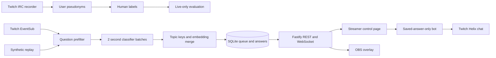

# Backlog

Backlog turns Twitch chat questions into a ranked queue for streamers.
It groups repeats and suggests only answers the streamer has saved.


## Setup

Requirements: Node.js 22 or newer and pnpm.

1. Create a Twitch application in the Twitch Developer Console. Set the OAuth redirect URL to `http://localhost:3001/auth/twitch/callback` if you use an external OAuth helper; this build currently accepts configured tokens from the environment and does not implement the login/callback flow.
2. Create a bot account. Authorize the bot user token with `user:read:chat` and `user:write:chat`. Configure a streamer/broadcaster token with the EventSub chat permission required for the channel. The current single `TWITCH_ACCESS_TOKEN` setting is used for both EventSub subscription and Helix chat sending, so use a token accepted for both during a live setup.
3. Copy `.env.example` to `.env` and fill the Twitch client ID/secret, access token, broadcaster and bot user IDs, bot username, channel, and `OPENAI_API_KEY` for live mode. Keep `.env` private.
4. Install and build:

   ```sh
   pnpm install
   pnpm build:web
   ```

The app currently uses the token values in `.env`; streamer OAuth login and token refresh are not implemented yet.

## Run

Demo mode is the default and uses deterministic local demo embeddings. It is for UI previews and cannot be used for evaluation.

```sh
pnpm replay data/sample-chat.synthetic.jsonl
```

Open [http://127.0.0.1:3001/control](http://127.0.0.1:3001/control). Open `/overlay` as an OBS browser source. The fixture is synthetic and is only for the replay demo.

For live chat, set `BACKLOG_MODE=live`, configure Twitch and OpenAI values in `.env`, set `CHANNEL`, `TWITCH_BROADCASTER_USER_ID`, `BOT_USER_ID`, and `BOT_USERNAME`, then run:

```sh
pnpm build:web
pnpm server
```

The cost guard defaults to 30 OpenAI calls per minute; change `OPENAI_MAX_CALLS_PER_MINUTE` if needed. The logs report token use. Bot chat messages share a queue capped at one message per 10 seconds.

## Record, label, evaluate

Capture public chat without a Twitch token. Every sender and explicit `@mention` is replaced with a stable `user_N` pseudonym before the JSONL file is written:

```sh
pnpm record-chat channel_name 10
pnpm label
```

`pnpm label` samples 150 messages, includes all prefilter candidates where possible, and asks for a yes/no label and a short topic key. After collecting and labelling real public chat, run evaluation only in live mode:

```sh
$env:BACKLOG_MODE='live' # PowerShell; use BACKLOG_MODE=live in POSIX shells
pnpm eval
```

The report is written to `docs/EVAL.md`. It compares the rules-only prefilter, a classifier without cross-batch context, and full Backlog. The repository does not contain real chat or human labels; do not treat the synthetic replay as evaluation data. `pnpm eval` refuses demo mode.

## Architecture



## Limits and safety

- Backlog does not generate answers. It suggests a saved answer only above the configured embedding threshold, and the bot sends only a saved answer selected by ID.
- Demo embeddings are local word-hash vectors. They are not semantic embeddings and demo mode is blocked from evaluation.
- Real evaluation depends on the channel mix and the quality of human labels. Duplicate pair accuracy is calculated over labelled question pairs.
- The current build has no OAuth login/callback or token refresh flow. Live access tokens must be configured outside the app.
- The recorder stores message text and pseudonymous user labels, not Twitch usernames or IDs. Avoid recording private information in public chat; captured files are local data and are not uploaded by the recorder.
- Twitch and OpenAI availability, API limits, and model pricing can change.

## Development

```sh
pnpm lint
pnpm test
pnpm exec tsc --noEmit
pnpm build:web
```

MIT licensed; see [LICENSE](LICENSE).
