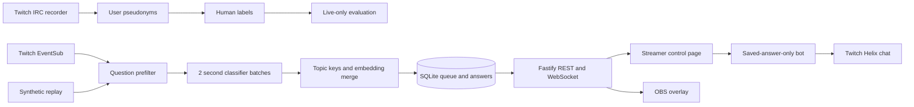

# Backlog

Backlog turns Twitch chat questions into a ranked queue for streamers.
It groups repeats and suggests only answers the streamer has saved.

## Quick start (demo, no Twitch needed)

Requirements: Node.js 22 or newer and pnpm.

The repository pins pnpm 11.13.0 through Corepack so bare `pnpm doctor` runs Backlog's readiness checklist.

```sh
pnpm install
pnpm build:web
pnpm replay data/sample-chat.synthetic.jsonl
```

`pnpm replay` starts the demo server and keeps running. Open [the control page](http://127.0.0.1:3001/control) and [the OBS overlay](http://127.0.0.1:3001/overlay). The synthetic fixture is only for replay demos; demo mode uses local hash embeddings and cannot be used for evaluation.

## Screenshots


## Live setup

1. Create a Twitch application in the Twitch Developer Console and copy its client ID and client secret. Backlog uses Twitch's Device Code Grant Flow, so no callback URL or callback server is needed.
2. Copy `.env.example` to `.env` and set `TWITCH_CLIENT_ID` and `TWITCH_CLIENT_SECRET`. The secret can be omitted if the app is registered as a public client. Keep `.env` private.
3. Authorize the broadcaster and bot separately. Sign into the broadcaster account when prompted by the first command, then the bot account for the second:

   ```sh
   pnpm auth streamer
   pnpm auth bot
   ```

   The streamer grant requests `user:read:chat`; the bot grant requests `user:read:chat` and `user:write:chat`. Enter the displayed code at Twitch's verification URL. Backlog validates and prints the Twitch login, then stores tokens and rotating refresh tokens in `.tokens/`, which Git ignores. The server refreshes tokens shortly before expiry and persists each rotated refresh token.

4. Set `CHANNEL` and `OPENAI_API_KEY` in `.env` for live mode. `TWITCH_BROADCASTER_USER_ID`, `BOT_USER_ID`, and `BOT_USERNAME` can be omitted when the matching device-code token files exist; Backlog reads these identities from Twitch. Keep `TWITCH_ACCESS_TOKEN` blank unless using it as a legacy fallback.
5. Install dependencies and build the UI:

   ```sh
   pnpm install
   pnpm build:web
   ```

Token files are local credentials. Do not copy or commit `.tokens/`.

## Doctor

After configuring live credentials, run:

```sh
pnpm doctor
```

Doctor checks Node.js, `.env`, required configuration, and both token files. It checks token expiry locally and asks Twitch to validate tokens when Twitch is reachable. It only reports whether environment values are set or missing, never their contents.

## Run live chat

Set `BACKLOG_MODE=live` in `.env`, then run:

```sh
pnpm server
```

The cost guard defaults to 30 OpenAI calls per minute; change `OPENAI_MAX_CALLS_PER_MINUTE` if needed. Logs report token use. Bot chat messages share a queue capped at one message per 10 seconds.

## Record, label, evaluate

Capture public chat without a Twitch token. Every sender and explicit `@mention` is replaced with a stable `user_N` pseudonym before the JSONL file is written:

```sh
pnpm record-chat channel_name 10
pnpm label
```

`pnpm label` samples 150 messages, includes all prefilter candidates where possible, and asks for a yes/no label and a short topic key. After collecting and labelling real public chat, run evaluation only in live mode:

```sh
$env:BACKLOG_MODE='live' # PowerShell; use BACKLOG_MODE=live in POSIX shells
pnpm eval
```

The report is written to `docs/EVAL.md`. It compares the rules-only prefilter, a classifier without cross-batch context, and full Backlog. The repository does not contain real chat or human labels; do not treat synthetic replay as evaluation data. `pnpm eval` refuses demo mode.

## Architecture



## Limits and safety

- Backlog does not generate answers. It suggests a saved answer only above the configured embedding threshold, and the bot sends only a saved answer selected by ID.
- Demo embeddings are local word-hash vectors. They are not semantic embeddings and demo mode is blocked from evaluation.
- Real evaluation depends on the channel mix and quality of human labels. Duplicate pair accuracy is calculated over labelled question pairs.
- Twitch's Device Code Grant Flow is used by the local CLI; it does not require a callback server. Revoked or expired refresh tokens require running `pnpm auth <streamer|bot>` again.
- The recorder stores message text and pseudonymous user labels, not Twitch usernames or IDs. Avoid recording private information in public chat; captures are local and are not uploaded by the recorder.
- Twitch and OpenAI availability, API limits, and model pricing can change.

## Development

```sh
pnpm lint
pnpm test
pnpm exec tsc --noEmit
pnpm build:web
```

MIT licensed; see [LICENSE](LICENSE).
